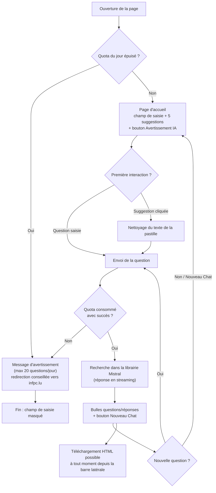
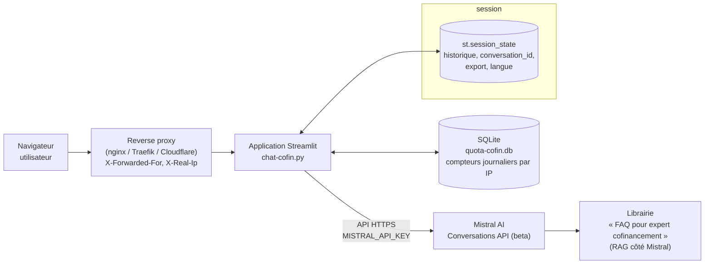
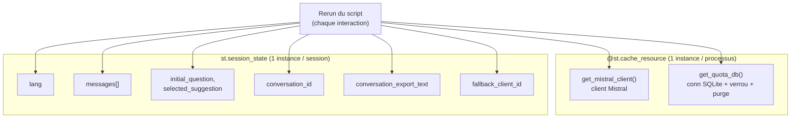
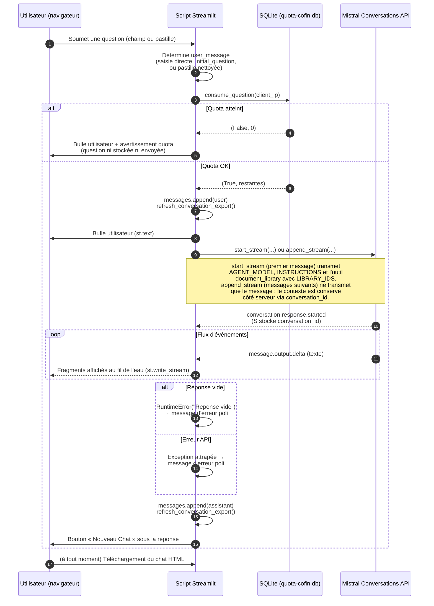
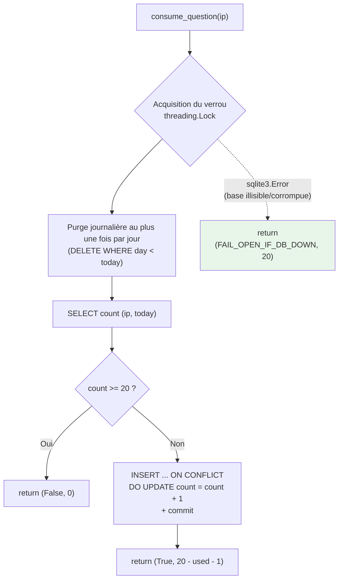
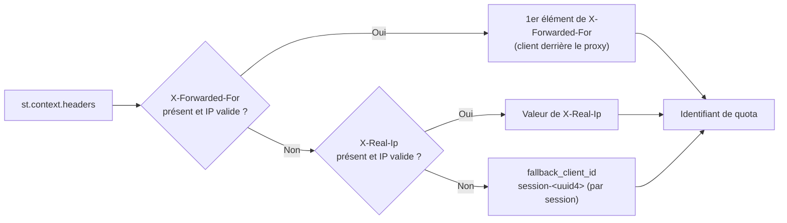
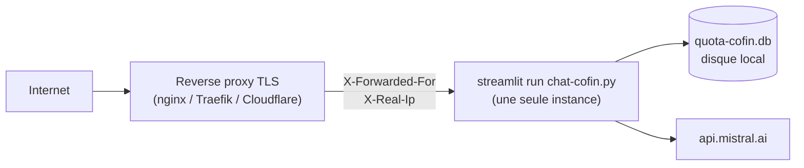

# Documentation fonctionnelle et technique — Chatbot Cofinancement (`chat-cofin.py`)

> Ce document décrit exclusivement le chatbot **chat-cofin**, l'application
> Streamlit du fichier `chat-cofin.py`. Les autres scripts Python du dépôt
> (notamment `chat-web.py` et `split_faq.py`) ne sont pas couverts ici.
>
> Historique du script :
> - 2024-06-10 : v1.0.0 — première version.

---

## Sommaire

1. [Documentation fonctionnelle](#1-documentation-fonctionnelle)
   - 1.1 Objectif
   - 1.2 Fonctionnalités offertes à l'utilisateur
   - 1.3 Questions suggérées
   - 1.4 Parcours utilisateur
   - 1.5 Règles de gestion
2. [Architecture](#2-architecture)
   - 2.1 Vue d'ensemble
   - 2.2 Pile technique
   - 2.3 Modèles et librairie Mistral
3. [Documentation technique](#3-documentation-technique)
   - 3.1 Modèle d'exécution Streamlit
   - 3.2 État de session
   - 3.3 Traitement d'une question (pas à pas)
   - 3.4 Gestion du quota journalier
   - 3.5 Identification du visiteur (IP)
   - 3.6 Internationalisation
   - 3.7 Export de la conversation en HTML
   - 3.8 Nettoyage du Markdown Streamlit
4. [Installation, configuration et exploitation](#4-installation-configuration-et-exploitation)
5. [Points d'attention et pistes d'amélioration](#5-points-dattention-et-pistes-damélioration)

---

## 1. Documentation fonctionnelle

### 1.1 Objectif

Le chatbot Cofinancement répond aux questions des entreprises sur le
**cofinancement de la formation professionnelle continue** au Luxembourg
(dispositif géré par l'INFPC).

Il est propulsé par un modèle de langage Mistral, mais ses réponses sont
**contraintes à une seule source de connaissances** : la librairie Mistral
*« FAQ pour expert cofinancement »*. Le chatbot ne doit pas inventer de
réponses, ni donner de conseils juridiques ou financiers ; si la librairie ne
contient pas la réponse, il invite l'utilisateur à contacter l'INFPC au
+352 26 20 40.

### 1.2 Fonctionnalités offertes à l'utilisateur

| Fonctionnalité | Description |
|---|---|
| Question libre | Saisie d'une question en langage naturel dans le champ de chat. |
| Questions suggérées | Cinq questions d'exemple cliquables (pastilles), affichées sur la page d'accueil. |
| Réponse en streaming | La réponse s'affiche au fur et à mesure de sa génération, avec un indicateur « Je recherche dans mes connaissances... ». |
| Bilingue | Interface et suggestions en français ou en anglais, au choix via la barre latérale. La réponse est produite dans la langue de la question. |
| Nouveau chat | Bouton (barre latérale et fin de conversation) qui efface l'historique et ouvre un nouveau fil de discussion. |
| Export de la conversation | Téléchargement de toute la conversation au format HTML autonome, depuis la barre latérale. |
| Avertissement sur l'IA | Pop-up (`@st.dialog`) détaillant les limites du système et l'absence de responsabilité de l'INFPC. |
| Quota d'usage | Maximum de **20 questions par jour et par adresse IP**, avec compteur « questions restantes » affiché en permanence dans la barre latérale. |
| Historique de conversation | Le fil complet (questions/réponses) reste affiché en bulles pendant la session, avec avatars distincts utilisateur / assistant. |

### 1.3 Questions suggérées

Les cinq suggestions affichées sous le champ de saisie de la page d'accueil :

| Clé | Français | Anglais |
|---|---|---|
| q1 | Quels salariés sont éligibles au cofinancement ? | Which employees are eligible for co-financing? |
| q2 | Les frais de déplacement sont-ils éligibles ? | Are travel expenses eligible? |
| q3 | Où trouver les informations sur la masse salariale ? | Where can I find information on payroll? |
| q4 | Quelles pièces justificatives sont obligatoires ? | Which supporting documents are mandatory? |
| q5 | Pour quand faut-il rendre ma demande ? | What is the duedate for my request for cofunding? |

Chaque suggestion est affichée sous forme de pastille (`st.pills`) colorée
avec une icône Material. Lorsqu'une suggestion est cliquée, le texte affiché
est nettoyé de ses marqueurs Streamlit (icône, couleur) avant d'être envoyé
comme question (voir [3.8](#38-nettoyage-du-markdown-streamlit)).

### 1.4 Parcours utilisateur



Points notables du parcours :

- **Deux pages, un seul script.** Tant qu'aucune question n'a été posée et
  qu'il n'y a pas d'historique, l'application affiche une page d'accueil
  (champ de saisie + suggestions) puis s'arrête (`st.stop()`). Dès la première
  question, l'interface passe en mode « chat » classique : historique en
  bulles et champ de saisie en bas de page.
- **Quota épuisé :** si le quota est atteint, la page d'accueil n'affiche même
  pas le champ de saisie, seulement l'avertissement. En cours de conversation,
  une question au-delà du quota est affichée côté utilisateur mais n'est ni
  enregistrée dans l'historique ni envoyée au modèle — seule la barre latérale
  (dont le bouton de téléchargement) reste fonctionnelle.

### 1.5 Règles de gestion

| # | Règle |
|---|---|
| R1 | Les réponses se basent **uniquement** sur la librairie « FAQ pour expert cofinancement ». |
| R2 | Si la librairie ne contient pas la réponse, inviter à contacter l'INFPC au +352 26 20 40. |
| R3 | Ne jamais inventer de réponse ; ne jamais donner de conseils juridiques ou financiers (instructions système). |
| R4 | Répondre dans la langue de la question (français ou anglais). |
| R5 | Maximum 20 questions par jour et par adresse IP (compteur partagé par toutes les sessions d'une même IP). |
| R6 | Le quota ne se décrémente que lorsqu'une question est réellement soumise — jamais sur un simple re-render (clic sur un bouton, changement de langue...). |
| R7 | Si la base de données de quota est indisponible, le chatbot reste disponible (« fail open ») : la disponibilité est privilégiée sur la maîtrise des coûts. |
| R8 | Le fil de discussion Mistral (`conversation_id`) est propre à une conversation ; « Nouveau Chat » en redemande un nouveau au message suivant. |
| R9 | L'utilisateur est informé du caractère automatique et non garanti des réponses via l'avertissement IA. |

---

## 2. Architecture

### 2.1 Vue d'ensemble



L'application est un script Streamlit monoprocessus. La recherche documentaire
(RAG) n'est **pas** implémentée dans le script : elle est déléguée à Mistral
via l'API Conversations et son outil `document_library`, qui interroge la
librairie configurée côté console Mistral.

### 2.2 Pile technique

| Composant | Rôle |
|---|---|
| **Python / Streamlit** | Framework d'application web ; le script entier est une page Streamlit. |
| **mistralai** (classe `Mistral`) | Client HTTP vers l'API Mistral ; utilisé ici uniquement pour l'API Conversations en streaming. |
| **sqlite3** (standard) | Compteurs de quota journaliers, persistés dans `quota-cofin.db`. |
| **threading** (standard) | Verrou protégeant la séquence lire-puis-écrire du quota entre les threads des sessions Streamlit. |
| **markdown** | Conversion de la conversation en HTML pour l'export (extension `tables`). |
| **htbuilder** (`div`, `styles`, `rem`) | Importé par le script ; disponible pour la construction d'HTML côté Python. |
| **re**, **uuid**, **datetime**, **pathlib** (standard) | Validation d'IP, identifiant de repli, dates du quota, chemins de fichiers. |

Dépendances déclarées dans `requirements.txt` : `streamlit`, `mistralai`,
`htbuilder`, `markdown`.

### 2.3 Modèles et librairie Mistral

| Élément | Valeur | Usage |
|---|---|---|
| `AGENT_MODEL` | `mistral-large-latest` | Modèle utilisé pour la conversation (démarrage du fil via `start_stream`). |
| `MODEL` | `mistral-small-latest` | Constante déclarée mais **non utilisée** dans le flux de conversation de ce script. |
| `LIBRARY_IDS` | `019fa84f-323a-7250-b211-ab0283ec1362` | Librairie « FAQ pour expert cofinancement », passée à l'outil `document_library`. |
| `INSTRUCTIONS` | Voir ci-dessous | Prompt système transmis au démarrage de la conversation. |

Texte exact des instructions système :

```
Réponds aux questions en te basant uniquement sur la librairie fournie.
Réponds dans la langue de la question (français ou anglais).
Si la librairie ne contient pas la réponse, invite à contacter l'INFPC au +352 26 20 40.
Ne pas inventer de réponses.
Ne pas donner de conseils juridiques ou financiers.
```

La librairie est gérée dans **Mistral Studio**, onglet
« Document Libraries » :
`https://console.mistral.ai/libraries/019fa84f-323a-7250-b211-ab0283ec1362`.
Son contenu correspond à la FAQ découpée dans `documents/faq_split/`
(un fichier `.md` par question-réponse), assemblée dans `documents/faq.md`.

---

## 3. Documentation technique

### 3.1 Modèle d'exécution Streamlit

Streamlit relance le script **de haut en bas à chaque interaction**. Le script
n'est donc pas organisé comme un programme séquentiel classique, mais comme
une suite de blocs idempotents :

- Les ressources coûteuses sont créées **une seule fois pour tout le
  processus** grâce à `@st.cache_resource` :
  - `get_mistral_client()` — client `Mistral` (clé lue dans
    `st.secrets["MISTRAL_API_KEY"]`) ;
  - `get_quota_db()` — connexion SQLite partagée par toutes les sessions
    (voir [3.4](#34-gestion-du-quota-journalier)).
- L'état par utilisateur (historique, langue, `conversation_id`...) vit dans
  `st.session_state`.
- Les fonctions utilitaires (`is_valid_ip`, `get_avatar`,
  `remove_streamlit_markdown`, `clear_conversation`, `build_conversation_text`...)
  sont pures ou ne touchent que l'état de session.

Schéma des rôles :



Deux astuces notoires du code :

- `st.container()` vide dans la bulle assistant : contournement du « ghost
  message bug » de Streamlit (message fantôme lors des re-rendus).
- Après un refus de quota, le code met `user_message` à `None` **plutôt que**
  d'appeler `st.stop()`, afin que la barre latérale (et son bouton de
  téléchargement) reste affichée.

### 3.2 État de session

| Clé `st.session_state` | Rôle | Initialisation / remise à zéro |
|---|---|---|
| `lang` | Langue d'interface (`"fr"` par défaut). | Sélecteur de la barre latérale. |
| `messages` | Liste `[{role, content}]` de l'historique affiché. | `[]` sur la page d'accueil sans interaction ; vidé par `clear_conversation()`. |
| `initial_question` | Question saisie sur la page d'accueil (clé du widget `st.chat_input`). | Consommée puis ignorée dès qu'un `user_message` existe. |
| `selected_suggestion` | Clé de la pastille cliquée (`q1`...`q5`). | Idem. |
| `conversation_id` | Identifiant du fil Mistral côté serveur. | `None` tant qu'aucun fil n'est démarré ; remis à `None` par `clear_conversation()`. |
| `conversation_export_text` | Dernier HTML d'export généré. | `""` ; régénéré à chaque message et alimente `st.download_button`. |
| `fallback_client_id` | Identifiant `session-<uuid4>` si l'IP est introuvable. | Créé à la demande dans `get_client_ip()`. |
| `prev_question_timestamp` | Horodatage de la question précédente. | `datetime.datetime.fromtimestamp(0)` (époque). Réservé à un usage d'anti-spam ; non exploité ailleurs dans cette version. |

`clear_conversation()` (bouton « Nouveau Chat ») remet à zéro tous les états
de conversation, y compris `conversation_id` : le fil Mistral précédent n'est
pas réutilisé et un nouveau fil sera créé au prochain message.

### 3.3 Traitement d'une question (pas à pas)



Détails d'implémentation importants :

1. **Ordre des traitements.** L'historique existant est affiché *avant* le
   traitement de la nouvelle question ; la question n'est ajoutée à
   `messages` et le quota n'est décompté **que si `user_message` est non
   vide** — c'est le seul point d'incrémentation du quota.
2. **Fonction génératrice `ask_mistral`.** Le dialogue avec Mistral est
   encapsulé dans un générateur qui `yield` chaque fragment de texte, ce qui
   permet le rendu progressif via `st.write_stream`. Le générateur est
   construit dans le bloc `st.spinner(t["searching"])` (affiche « Je recherche
   dans mes connaissances... ») mais son exécution réelle a lieu dans
   `st.write_stream`.
3. **Gestion des évènements du flux.** Deux types d'évènements sont traités :
   - `conversation.response.started` → récupération du
     `conversation_id` (seulement au premier message) ;
   - `message.output.delta` → le champ `content` peut être une chaîne pure
     ou une **liste mélangeant texte et citations** ; seuls les chunks de
     type `"text"` sont conservés et affichés (les citations sont ignorées).
4. **Robustesse.** Si aucun contenu n'a été reçu (`got_content` faux) ou si
   l'appel API lève une exception, le générateur attrape tout et `yield` un
   message d'excuse bilingue au lieu de faire planter la page. L'erreur est
   également imprimée dans les logs du serveur (`print`).
5. **Antidoublon page d'accueil.** La question de la page d'accueil est
   reprise depuis `st.session_state.initial_question` (clé du widget) et non
   depuis la valeur de retour du second `st.chat_input` de la page chat, pour
   éviter de perdre la saisie lors de la transition entre les deux pages.

### 3.4 Gestion du quota journalier

Objectif : limiter à `MAX_QUESTIONS_PER_DAY = 20` le nombre de questions par
jour civil et par adresse IP, en persistant les compteurs pour qu'ils
survivent aux redémarrages de l'application.

**Choix de SQLite.** Par rapport à un dictionnaire en mémoire : les compteurs
survivent aux redémarrages, aucun service supplémentaire à installer, et le
fichier est inspectable à la main (`sqlite3 quota-cofin.db "SELECT ..."`).
Limite assumée : SQLite ne coordonne **pas** plusieurs machines ; le design
est valable tant qu'il n'y a qu'un seul `streamlit run`.

**Schéma de la table :**

```sql
CREATE TABLE IF NOT EXISTS quota (
    ip    TEXT    NOT NULL,
    day   TEXT    NOT NULL,          -- date ISO, ex. 2026-09-30
    count INTEGER NOT NULL DEFAULT 0,
    PRIMARY KEY (ip, day)
) WITHOUT ROWID;
```

**Mécanisme :**



Points clés :

- **Verrou `threading.Lock`.** Chaque session Streamlit tourne dans un thread
  différent ; le verrou rend atomique la séquence lire-puis-écrire. La
  connexion SQLite est ouverte avec `check_same_thread=False` (exigé par
  sqlite3 dans ce contexte multithread) et `timeout=5` secondes.
- **PRAGMA.** `journal_mode=WAL` et `synchronous=NORMAL` : bon compromis
  performance/intégrité pour cette charge faible.
- **Purge paresseuse.** `_purge_old_days` supprime les lignes des jours
  passés au plus **une fois par jour** (mémoïsé dans `store["purged_on"]`),
  à l'intérieur du verrou.
- **Fail open.** `FAIL_OPEN_IF_DB_DOWN = True` : en cas d'erreur SQLite
  (disque plein, droits, corruption), la question est laissée passer et
  l'affichage montre un quota complet. Inverser ce drapeau privilégierait la
  maîtrise des coûts au détriment de la disponibilité.
- **Lecture sans décompte.** `remaining_questions(ip)` alimente uniquement
  l'affichage « Questions restantes aujourd'hui : n / 20 » de la barre
  latérale et le test de la page d'accueil ; elle n'incrémente jamais le
  compteur (aucun comptage sur les simples re-rendus).
- **Fichier.** `QUOTA_DB_PATH = quota-cofin.db` à côté du script ; il doit
  être inscriptible par l'utilisateur qui lance Streamlit et résider sur un
  disque local (jamais un partage NFS).

### 3.5 Identification du visiteur (IP)

`get_client_ip()` détermine l'identifiant utilisé pour le quota :



Précisions :

- La validation `is_valid_ip()` est **volontairement minimaliste** : une
  simple regex `^(\d{1,3}\.){3}\d{1,3}$` (format IPv4, sans contrôle
  0-255, IPv6 ignorée par choix).
- Sans reverse proxy positionnant ces en-têtes, tous les visiteurs
  partagent l'IP du serveur ; le repli sur `fallback_client_id` évite alors
  de pénaliser tout le monde du même quota — mais un quota « par session »
  devient alors re-déclencheable en rechargeant la page.
- `st.context.headers` est lu dans un `try/except` (tolérance aux contextes
  où l'API n'est pas disponible).

### 3.6 Internationalisation

- Deux langues : `fr` (défaut) et `en`, via un `st.selectbox` de la barre
  latérale (`Français` / `English`).
- Le dictionnaire `translations` fournit tous les libellés d'interface
  (titre, invite de saisie, messages de quota, avertissement...) ; la
  fonction `translate_suggestions()` recopie dans la variable globale
  `suggestions` le jeu `SUGGESTIONS_FR` ou `SUGGESTIONS_EN` correspondant.
- La langue de **l'interface** est un choix explicite de l'utilisateur ; la
  langue de **la réponse** est laissée au modèle via l'instruction « Réponds
  dans la langue de la question ».
- Le pop-up d'avertissement IA et le message d'erreur du générateur sont
  également bilingues (`st.session_state.lang`).

### 3.7 Export de la conversation en HTML

Chaîne de traitement :

```
st.session_state.messages
        │  build_conversation_text()
        ▼
Markdown interpolé ("## Question:" / "## Réponse:" par message)
        │  markdown.markdown(extensions=["tables"])
        ▼
HTML du corps
        │  habillage dans un gabarit complet
        ▼
st.session_state.conversation_export_text
        │  st.download_button (barre latérale)
        ▼
chat_YYYYMMDD_HHMM.htm
```

- `refresh_conversation_export()` est rappelé **après chaque message**
  (utilisateur et assistant) : le fichier téléchargeable est toujours à jour,
  y compris pendant une session active.
- Le bouton de téléchargement est désactivé tant qu'aucun message n'a été
  échangé (`disabled=not conversation_export_text`).
- Le gabarit embarque un style minimal (Arial, bordures de table, liens
  orange INFPC `#ff6e00`) : le fichier `.htm` est autonome, sans dépendance
  externe.
- Le titre de l'export est « Rechercher avec l'IA - Chatbot
  lifelong-learning.lu » (intitulé historique, repris tel quel du script).
- Après un refus de quota, l'export reste disponible : c'est la raison pour
  laquelle le script neutralise `user_message` au lieu d'appeler `st.stop()`.

### 3.8 Nettoyage du Markdown Streamlit

Les pastilles de suggestions contiennent des marqueurs propres à Streamlit
(`:material/local_library:`, `:blue[...]`, ...). `remove_streamlit_markdown()`
les retire avant d'envoyer le texte au modèle :

1. suppression des icônes Material : `:material/...:` ;
2. extraction du contenu des marqueurs de couleur
   (`:red[...]`, `:blue[...]`, `:green[...]`, `:orange[...]`, `:yellow[...]`,
   `:violet[...]`, `:gray[...]`, `:grey[...]`) — le texte entre crochets est
   conservé.

Résultat : la question envoyée à Mistral est un texte brut, sans sucre
syntaxique Streamlit.

### 3.9 Autres éléments d'interface

- **Avatars** (`get_avatar`) : `images/avatar-bot-blue.png` pour
  l'assistant, `images/avatar-user-blue.png` pour l'utilisateur (variante
  « blue » propre au chatbot cofinancement).
- **Logos** : `images/infpc.svg` dans la barre latérale, `images/chatlib.svg`
  en haut de page (cliquable vers https://www.infpc.lu).
- **Configuration de page** : titre d'onglet « Chatbot Cofinancement »,
  icône robot, `initial_sidebar_state="auto"` (la barre latérale se replie
  automatiquement).
- **Avertissement IA** : bouton tertiaire discret sous les suggestions,
  ouvrant un `@st.dialog` bilingue.

---

## 4. Installation, configuration et exploitation

### 4.1 Prérequis

- Python 3.10+ (le script utilise `tuple[bool, int]` en annotation).
- Un environnement virtuel (le `run.sh` attend `./.venv`).
- Une clé API Mistral (`MISTRAL_API_KEY`) avec accès à l'API Conversations
  (beta) et à la librairie
  `019fa84f-323a-7250-b211-ab0283ec1362`.
- Droits d'écriture sur le répertoire du script (création de
  `quota-cofin.db`).

### 4.2 Installation

```bash
python -m venv .venv
source .venv/bin/activate    # Windows : .venv\Scripts\activate
pip install -r requirements.txt
```

### 4.3 Secrets

La clé API est lue via `st.secrets["MISTRAL_API_KEY"]`. Deux options usuelles
Streamlit :

- `.streamlit/secrets.toml` à la racine du projet :

  ```toml
  MISTRAL_API_KEY = "..."
  ```

- ou variables d'environnement équivalentes selon le mécanisme
  `st.secrets` en vigueur dans l'environnement de déploiement.

Ne jamais commiter les secrets (le dépôt applique déjà ce principe).

### 4.4 Lancement

```bash
# Via le script fourni (utilise .venv) :
./run.sh

# Ou directement :
streamlit run chat-cofin.py
```

L'application est alors servie sur le port Streamlit par défaut (8501).

### 4.5 Déploiement recommandé



- **Une seule instance Streamlit** : le quota SQLite et son verrou ne sont
  valables que dans un seul processus ; ne pas mettre à l'échelle
  horizontalement sans reprendre la gestion du quota.
- **Reverse proxy obligatoire** pour l'identification par IP (en-têtes
  `X-Forwarded-For` / `X-Real-Ip`) et pour la terminaison TLS.
- **Disque local** pour `quota-cofin.db` (pas de NFS).

### 4.6 Exploitation

| Besoin | Commande / action |
|---|---|
| Consulter les compteurs du jour | `sqlite3 quota-cofin.db "SELECT * FROM quota"` |
| Réinitialiser le quota d'une IP | `sqlite3 quota-cofin.db "DELETE FROM quota WHERE ip = 'x.x.x.x'"` |
| Vider tous les compteurs | `sqlite3 quota-cofin.db "DELETE FROM quota"` |
| Diagnostiquer une erreur API | Lire la sortie du serveur Streamlit (`print` de l'exception) |
| Modifier les questions suggérées | Éditer `SUGGESTIONS_FR` / `SUGGESTIONS_EN` dans le script |
| Modifier le ton / les garde-fous | Éditer `INSTRUCTIONS` dans le script |
| Mettre à jour la base de connaissances | Mistral Studio > Document Libraries > « FAQ pour expert cofinancement » |
| Ajuster la limite journalière | Éditer `MAX_QUESTIONS_PER_DAY` |

Les purge automatique des jours passés se déclenche au premier usage de chaque
nouveau jour ; il n'y a donc pas de cron à maintenir.

---

## 5. Points d'attention et pistes d'amélioration

| # | Point | Détail / piste |
|---|---|---|
| 1 | `MODEL` (`mistral-small-latest`) inutilisé | Constante déclarée mais non référencée dans le flux de conversation ; à supprimer ou à documenter comme prévision d'usage futur. |
| 2 | Citations ignorées | Les chunks de citations renvoyés par l'API Conversations sont filtrés ; afficher les sources des réponses renforcerait la confiance. |
| 3 | Quota mono-instance | SQLite ne coordonne pas plusieurs machines. Pour un déploiement multi-instances : Postgres/Redis, ou quota délégué à un service partagé. |
| 4 | Validation IP minimaliste | La regex accepte des octets > 255 et ignore IPv6 ; suffisant en l'état, à durcir si le quota devient un enjeu de coûts. |
| 5 | Quota contournable | L'IP est lue dans des en-têtes client-contrôlables en amont du proxy ; derrière Cloudflare, préférer l'IP de connexion réelle fournie par le CDN. Le repli `fallback_client_id` est re-déclencheable en rechargeant la page. |
| 6 | `FAIL_OPEN_IF_DB_DOWN = True` | Choix « disponibilité » : une panne de la base supprime la limite journalière. À inverser si la maîtrise des coûts devient prioritaire. |
| 7 | Titre d'export incohérent | L'export HTML s'intitule « Chatbot lifelong-learning.lu » alors qu'il s'agit du chatbot Cofinancement (intitulé repris de l'autre chatbot). |
| 8 | `prev_question_timestamp` inutilisé | État de session réservé à un anti-spam par horodatage, non exploité dans cette version ; à implémenter ou retirer. |
| 9 | `htbuilder` importé non utilisé | `div`, `styles`, `rem` sont importés mais le script n'en fait pas usage ; dépendance à nettoyer. |
| 10 | Historique en mémoire de session | `messages` vit dans `st.session_state` : un rechargement de page efface la conversation (le fil Mistral côté serveur subsiste, identifié par l'ancien `conversation_id` devenu inaccessible). |
