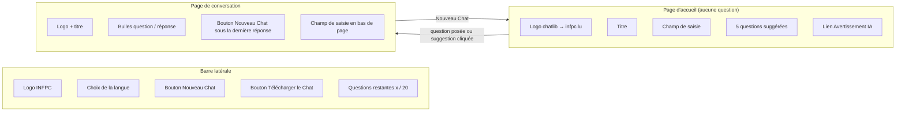
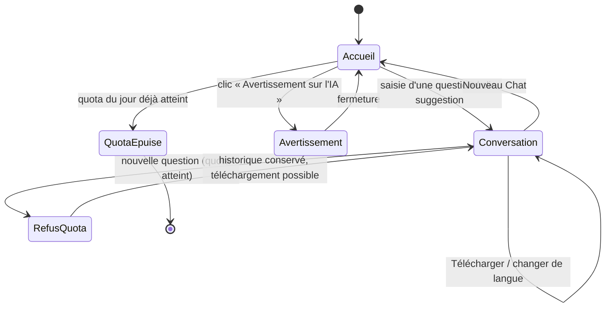
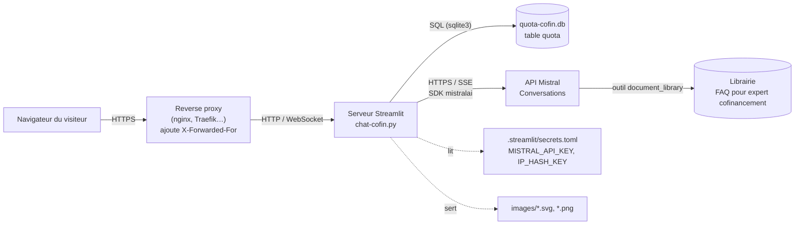
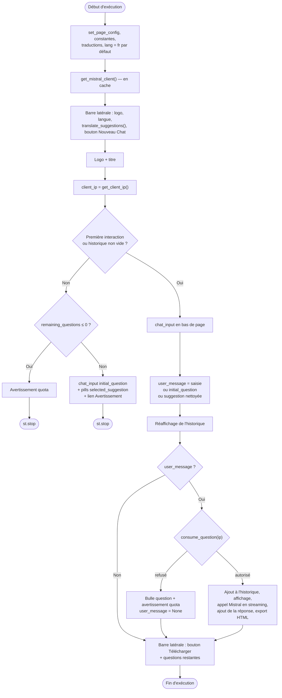
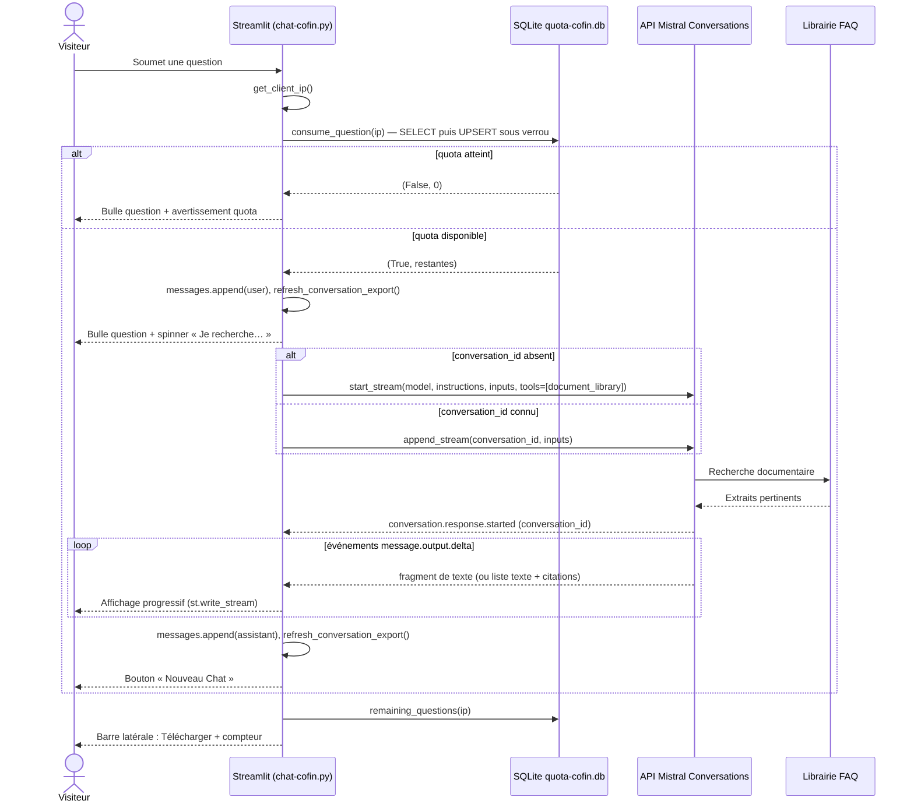
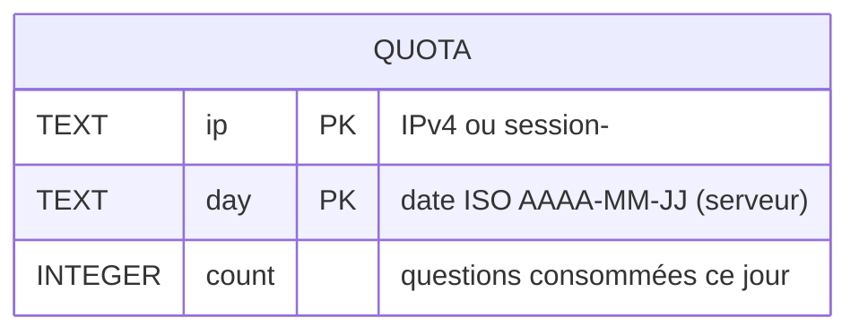
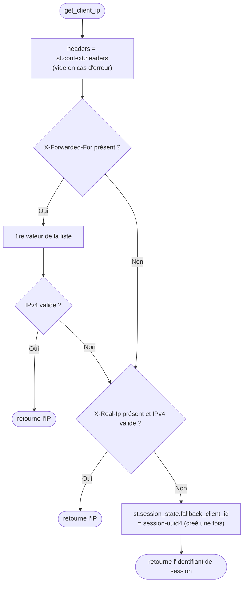
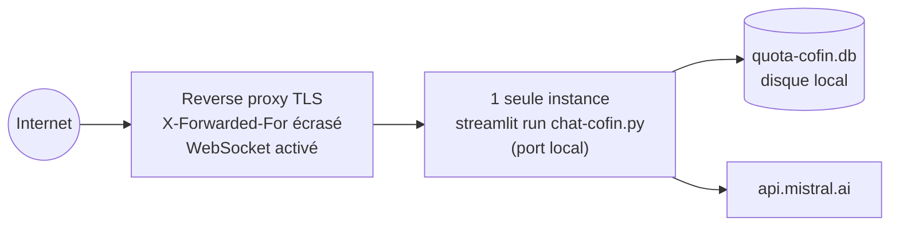

# Chatbot Cofinancement — Documentation fonctionnelle et technique

> **Périmètre** : ce document décrit uniquement l'application `chat-cofin.py`.
> Les autres scripts Python du dépôt (`chat-web.py`, `documents/split_faq.py`)
> ne sont pas couverts.

| Élément | Valeur |
|---|---|
| Fichier | `chat-cofin.py` (≈ 660 lignes) |
| Type | Application web Streamlit (mono-fichier) |
| Moteur IA | API Mistral « Conversations » + outil `document_library` (RAG) |
| Modèle utilisé | `mistral-large-latest` |
| Base de connaissances | Librairie Mistral « FAQ pour expert cofinancement » (`019fa84f-323a-7250-b211-ab0283ec1362`) |
| Persistance locale | SQLite `quota-cofin.db` (quota journalier uniquement) |
| Langues | Français (par défaut), anglais |
| Version déclarée | v1.0.0 (en-tête du script) |

---

## Sommaire

1. [Documentation fonctionnelle](#1-documentation-fonctionnelle)
2. [Architecture](#2-architecture)
3. [Documentation technique](#3-documentation-technique)
4. [Installation, configuration et exploitation](#4-installation-configuration-et-exploitation)
5. [Points d'attention et pistes d'amélioration](#5-points-dattention-et-pistes-damélioration)
6. [Annexe — référence des fonctions et constantes](#6-annexe--référence-des-fonctions-et-constantes)

---

## 1. Documentation fonctionnelle

### 1.1 Objectif

Le chatbot permet à un visiteur (typiquement un responsable RH ou formation
d'une entreprise luxembourgeoise) de poser, en langage naturel, des questions
sur le **cofinancement de la formation professionnelle continue** géré par
l'INFPC.

Les réponses sont produites par un modèle Mistral **contraint à s'appuyer
uniquement sur une librairie documentaire** (la FAQ cofinancement hébergée dans
Mistral Studio). Les consignes données au modèle sont :

- répondre uniquement à partir de la librairie fournie ;
- répondre dans la langue de la question (français ou anglais) ;
- si la librairie ne contient pas la réponse, inviter à contacter l'INFPC au
  **+352 26 20 40** ;
- ne pas inventer de réponses ;
- ne pas donner de conseils juridiques ou financiers.

### 1.2 Fonctionnalités

| # | Fonctionnalité | Description |
|---|---|---|
| F1 | Poser une question | Champ de saisie « Posez votre question » / « Ask your question ». |
| F2 | Questions suggérées | 5 questions cliquables (« pills ») sur la page d'accueil. |
| F3 | Réponse en streaming | La réponse s'affiche au fil de l'eau, précédée du message « Je recherche dans mes connaissances… ». |
| F4 | Conversation suivie | Les questions suivantes s'inscrivent dans le même fil : le modèle garde le contexte. |
| F5 | Nouveau chat | Bouton dans la barre latérale et sous chaque réponse : efface l'historique et démarre un nouveau fil. |
| F6 | Choix de la langue | Liste déroulante Français / English dans la barre latérale : traduit l'interface et les suggestions. |
| F7 | Téléchargement | Bouton « Télécharger le Chat » : exporte la conversation au format HTML (`chat_AAAAMMJJ_HHMM.htm`). |
| F8 | Avertissement IA | Lien discret sur la page d'accueil ouvrant une fenêtre de mise en garde (non-responsabilité de l'INFPC). |
| F9 | Quota journalier | 20 questions par jour et par visiteur ; compteur « Questions restantes aujourd'hui : x / 20 » dans la barre latérale. |

### 1.3 Questions suggérées

| Clé | Français | English |
|---|---|---|
| q1 | Quels salariés sont éligibles au cofinancement ? | Which employees are eligible for co-financing? |
| q2 | Les frais de déplacement sont-ils éligibles ? | Are travel expenses eligible? |
| q3 | Où trouver les informations sur la masse salariale ? | Where can I find information on payroll? |
| q4 | Quelles pièces justificatives sont obligatoires ? | Which supporting documents are mandatory? |
| q5 | Pour quand faut-il rendre ma demande ? | What is the duedate for my request for cofunding? |

Chaque suggestion est affichée avec une icône Material et une couleur ;
ces décorations sont retirées avant l'envoi au modèle (voir §3.8).

### 1.4 Écrans



### 1.5 Parcours utilisateur



### 1.6 Règles de gestion

| Code | Règle |
|---|---|
| RG1 | Un visiteur peut poser au maximum **20 questions par jour calendaire** (date du serveur). |
| RG2 | Le visiteur est identifié par son **adresse IPv4** transmise par le reverse proxy ; à défaut, par un identifiant de session aléatoire. Cet identifiant n'est jamais stocké en clair : seule son empreinte HMAC-SHA256 (clé `IP_HASH_KEY`) est enregistrée. |
| RG3 | Seule la soumission effective d'une question consomme le quota (pas les changements de langue, clics sur boutons, rafraîchissements d'écran). |
| RG4 | Une question refusée pour quota n'est **ni envoyée au modèle, ni enregistrée** dans l'historique. |
| RG5 | Si la page d'accueil est affichée alors que le quota est épuisé, le champ de saisie n'est pas proposé : seul le message de quota apparaît. |
| RG6 | Une question dont la réponse a échoué (erreur API) **consomme quand même** une unité de quota. |
| RG7 | Si la base de quota est indisponible, les questions sont **autorisées** (mode *fail-open*, paramétrable). |
| RG8 | « Nouveau Chat » ouvre un nouveau fil côté Mistral : le contexte de la conversation précédente n'est plus utilisé. |
| RG9 | La conversation n'est **pas persistée** côté serveur applicatif : elle disparaît à la fermeture/rechargement de l'onglet (elle reste stockée côté Mistral sous son `conversation_id`). |
| RG10 | Changer de langue ne réinitialise pas la conversation ; seule l'interface est traduite. La langue de réponse suit la langue de la question. |

---

## 2. Architecture

### 2.1 Vue d'ensemble



L'application est **sans état métier local** : tout le raisonnement et la
recherche documentaire (RAG) sont délégués à Mistral. Le serveur Streamlit ne
gère que l'interface, l'historique d'affichage de la session, l'export HTML et
le quota.

### 2.2 Pile technique

| Composant | Rôle |
|---|---|
| Python 3.10+ | Syntaxe `tuple[bool, int]` dans les annotations. |
| `streamlit` | Interface web : `st.chat_input`, `st.chat_message`, `st.pills`, `st.dialog`, `st.write_stream`, `st.context.headers`, `st.cache_resource`… (version récente requise, cf. paramètre `width="stretch"`). |
| `mistralai` | Client `Mistral` ; API `client.beta.conversations.start_stream` / `append_stream`. |
| `markdown` | Conversion Markdown → HTML pour l'export (extension `tables`). |
| `sqlite3`, `threading` | Stockage et verrouillage du quota (bibliothèque standard). |
| `htbuilder` | Importé mais **non utilisé**. |

### 2.3 Côté Mistral

- **Modèle** : `AGENT_MODEL = "mistral-large-latest"`. La constante
  `MODEL = "mistral-small-latest"` est déclarée mais non utilisée.
- **Librairie** : gérée dans Mistral Studio, *Document Libraries* >
  « FAQ pour expert cofinancement »
  (<https://console.mistral.ai/libraries/019fa84f-323a-7250-b211-ab0283ec1362>).
  Mettre à jour la FAQ se fait **dans la console Mistral**, sans modifier ni
  redéployer l'application.
- **Historique** : conservé côté Mistral via un `conversation_id`. L'application
  n'envoie à chaque tour que la nouvelle question.

---

## 3. Documentation technique

### 3.1 Modèle d'exécution Streamlit

Streamlit **ré-exécute le script entier de haut en bas** à chaque interaction
(saisie, clic, changement de liste). La persistance entre deux exécutions
repose sur `st.session_state` (par onglet) et `st.cache_resource` (par
processus, partagé entre toutes les sessions).



Remarques :

- La page d'accueil se termine par `st.stop()` : le bouton de téléchargement et
  le compteur de quota ne sont donc **pas affichés** sur l'accueil.
- Lors d'un refus de quota en cours de conversation, le script **n'appelle
  pas** `st.stop()` mais neutralise `user_message`, afin que la barre latérale
  (téléchargement) reste disponible.
- Les widgets à clé `initial_question` et `selected_suggestion` ne sont rendus
  que sur l'accueil ; leur valeur n'est exploitée qu'à l'exécution suivant la
  soumission, puis Streamlit les supprime de l'état quand ils ne sont plus
  affichés. C'est ensuite `has_message_history` qui maintient l'écran de
  conversation.

### 3.2 État de session

| Clé `st.session_state` | Type | Rôle |
|---|---|---|
| `lang` | `"fr"` \| `"en"` | Langue de l'interface (valeur de la liste déroulante). |
| `messages` | `list[dict]` | Historique affiché : `{"role": "user"\|"assistant", "content": str}`. |
| `conversation_id` | `str \| None` | Identifiant du fil Mistral ; `None` ⇒ le prochain message crée un nouveau fil. |
| `conversation_export_text` | `str` | Document HTML complet prêt à télécharger ; vide ⇒ bouton désactivé. |
| `initial_question` | `str \| None` | Valeur du champ de saisie de la page d'accueil (clé de widget). |
| `selected_suggestion` | `str \| None` | Clé (`q1`…`q5`) de la suggestion cliquée (clé de widget). |
| `fallback_client_id` | `str` | `session-<uuid4>` utilisé comme identifiant de quota en l'absence d'IP. |
| `prev_question_timestamp` | `datetime` | Initialisé à l'epoch ; **non utilisé** par ailleurs. |

Ressources partagées (`@st.cache_resource`, une instance par processus) :

| Fonction | Ressource |
|---|---|
| `get_mistral_client()` | Client `Mistral(api_key=st.secrets["MISTRAL_API_KEY"])`. |
| `get_quota_db()` | `{"conn": sqlite3.Connection, "lock": threading.Lock, "purged_on": str \| None}`. |

La variable globale de module `suggestions` est recalculée à chaque exécution
par `translate_suggestions()` selon la langue.

### 3.3 Traitement d'une question



#### Générateur `ask_mistral(message)`

Défini à l'intérieur du bloc de réponse, c'est un **générateur** consommé par
`st.write_stream`, qui renvoie la concaténation des fragments.

1. Choix de l'appel :
   - `conversation_id` présent → `client.beta.conversations.append_stream(conversation_id=…, inputs=message)` ;
   - sinon → `client.beta.conversations.start_stream(model=AGENT_MODEL, instructions=INSTRUCTIONS, inputs=message, tools=[{"type": "document_library", "library_ids": LIBRARY_IDS}])`.
2. Parcours des événements du flux (`event.data.type`) :

   | Type d'événement | Traitement |
   |---|---|
   | `conversation.response.started` | Mémorise `data.conversation_id` dans la session. |
   | `message.output.delta` avec `content` de type `str` | Émis tel quel. |
   | `message.output.delta` avec `content` de type `list` | Seuls les morceaux `type == "text"` sont émis ; les références/citations sont ignorées. |
   | autres (appels d'outil, fin de réponse…) | Ignorés. |

3. Si aucun texte n'a été reçu → `RuntimeError("Reponse vide")`.
4. Toute exception est journalisée sur la sortie standard (`print`) et remplacée
   par un message d'excuse localisé (« Désole, je n'ai pas pu obtenir de
   réponse… » / « Sorry, I could not get an answer… »). Ce message est
   enregistré dans l'historique comme une réponse normale.

> Le spinner n'entoure que la *création* du générateur ; l'appel réseau
> démarre réellement lors de la consommation par `st.write_stream`.

### 3.4 Quota journalier

#### Modèle de données



```sql
CREATE TABLE IF NOT EXISTS quota (
    ip    TEXT    NOT NULL,
    day   TEXT    NOT NULL,
    count INTEGER NOT NULL DEFAULT 0,
    PRIMARY KEY (ip, day)
) WITHOUT ROWID;
```

Paramètres de connexion : `check_same_thread=False` (chaque session Streamlit
tourne dans son propre thread), `timeout=5`, `PRAGMA journal_mode=WAL`,
`PRAGMA synchronous=NORMAL`. Le fichier est créé automatiquement à côté du
script (`QUOTA_DB_PATH = Path(__file__).parent / "quota-cofin.db"`).

#### Algorithme `consume_question(ip)`

```mermaid
flowchart TD
    A([consume_question ip]) --> B["today = date.today().isoformat()"]
    B --> C["Acquisition du verrou"]
    C --> D{"purged_on == today ?"}
    D -- Non --> E["DELETE FROM quota WHERE day < today<br/>purged_on = today"]
    D -- Oui --> F
    E --> F["SELECT count WHERE ip, day"]
    F --> G{"used ≥ 20 ?"}
    G -- Oui --> R1(["return (False, 0)"])
    G -- Non --> H["INSERT … ON CONFLICT DO UPDATE count = count + 1<br/>COMMIT"]
    H --> R2(["return (True, 20 − used − 1)"])
    C -. sqlite3.Error .-> X(["return (FAIL_OPEN_IF_DB_DOWN, 20)"])
```

- Le **verrou** `threading.Lock` rend atomique la séquence lecture-puis-écriture
  entre sessions concurrentes d'un même processus.
- La **purge** des jours passés s'exécute au plus une fois par jour et par
  processus, lors de la première question du jour.
- `remaining_questions(ip)` lit le compteur **sans l'incrémenter** (affichage
  et contrôle de la page d'accueil). En cas d'erreur SQLite : 20 si
  *fail-open*, sinon 0.
- SQLite ne coordonne pas plusieurs serveurs : la solution suppose **une seule
  instance** `streamlit run`.

### 3.5 Identification du visiteur



`is_valid_ip` vérifie seulement le motif `^(\d{1,3}\.){3}\d{1,3}$` (pas de
contrôle 0-255). Les adresses **IPv6 sont rejetées** et basculent sur
l'identifiant de session.

### 3.6 Internationalisation

- Dictionnaire `translations["fr" | "en"]` : titre, libellés des boutons,
  spinner, lien d'avertissement, messages de quota (gabarits `{limit}`,
  `{remaining}`).
- `SUGGESTIONS_FR` / `SUGGESTIONS_EN` : copiées dans `suggestions` par
  `translate_suggestions()`.
- Le texte de la fenêtre d'avertissement (`show_disclaimer_dialog`) et le
  message d'erreur API sont codés en dur dans les deux langues.
- La langue de **réponse** est décidée par le modèle d'après la langue de la
  question (consigne dans `INSTRUCTIONS`), indépendamment du choix d'interface.

### 3.7 Export de la conversation

`build_conversation_text()` produit, sous le titre « Rechercher avec l'IA -
Chatbot lifelong-learning.lu », une suite de blocs « Question: » / « Réponse: ».
Chaque message est converti séparément en HTML
(`markdown.markdown(..., extensions=["tables"])`), chaque réponse étant placée
dans une `<section>` marquée IA (voir ci-dessous). Le tout est enveloppé dans une page autonome (`lang="fr"`, UTF-8, CSS inline : police
Arial, bordures de tableaux, liens orange `#ff6e00`).

`refresh_conversation_export()` régénère ce texte après chaque question et
chaque réponse ; le bouton `st.download_button` de la barre latérale propose le
fichier `chat_AAAAMMJJ_HHMM.htm` (`text/html`), désactivé tant que la
conversation est vide.

#### Marquage IA (art. 50, § 2 AI Act)

Les réponses générées sont marquées comme telles, de façon visible et lisible
par machine :

- **En session**, chaque réponse de l'assistant porte les champs
  `ai_generated: True`, `model` (`AGENT_MODEL`) et `generated_at`
  (horodatage ISO 8601 avec fuseau).
- **Dans l'interface**, une mention « Réponse générée par IA » / « AI-generated
  answer » (`translations[...]["ai_label"]`) s'affiche sous chaque réponse.
- **Dans le fichier exporté** :
  - `<head>` : `<meta name="generator">` (modèle utilisé),
    `<meta name="ai-generated" content="true">` et
    `<meta name="digital-source-type">` avec la valeur IPTC
    `trainedAlgorithmicMedia` ;
  - chaque réponse (et elle seule) est enveloppée dans
    `<section class="ai-generated" data-ai-generated="true" data-model="…"
    data-generated-at="…">` avec le libellé visible « Réponse générée par IA
    (Mistral) » ;
  - un pied de page rappelle que les réponses ont été générées par un système d'IA.

Limite : ces métadonnées ne survivent pas à un copier-coller du texte. Un
filigrane robuste d'un texte brut ne peut pas être ajouté côté application.

### 3.8 Nettoyage des suggestions

`remove_streamlit_markdown(text)` retire la syntaxe propre à Streamlit avant
l'envoi au modèle :

| Motif | Exemple | Résultat |
|---|---|---|
| `:material/xxx:` | `:material/database:` | supprimé |
| `:couleur[texte]` (red, blue, green, orange, yellow, violet, gray, grey) | `:green[:material/database:]` | contenu conservé |

Exemple : `":green[:material/database:] Les frais de déplacement sont-ils éligibles ?"`
→ `"Les frais de déplacement sont-ils éligibles ?"`.

### 3.9 Autres éléments d'interface

- `get_avatar(role)` : `images/avatar-bot-blue.png` pour l'assistant,
  `images/avatar-user-blue.png` pour l'utilisateur.
- Les questions sont affichées avec `st.text` (texte brut, pas de rendu
  Markdown) ; les réponses avec `st.markdown` / `st.write_stream`.
- `st.container()` vide placé en tête des bulles assistant : contournement du
  bug d'affichage « message fantôme » de Streamlit.
- `clear_conversation()` (callback `on_click`) : vide `messages`,
  `initial_question`, `selected_suggestion`, `conversation_export_text` et
  remet `conversation_id` à `None`.

---

## 4. Installation, configuration et exploitation

### 4.1 Arborescence utile

```text
mistral-chats/
├── chat-cofin.py            # l'application
├── requirements.txt         # streamlit, mistralai, htbuilder, markdown
├── run.sh                   # active .venv et lance chat-cofin.py
├── quota-cofin.db           # créée à l'exécution (ignorée par git : *.db)
├── .streamlit/
│   ├── config.toml          # configuration serveur / thème
│   └── secrets.toml         # MISTRAL_API_KEY, IP_HASH_KEY (ignoré par git)
└── images/
    ├── infpc.svg, chatlib.svg
    └── avatar-bot-blue.png, avatar-user-blue.png
```

### 4.2 Installation

```bash
python -m venv .venv
source .venv/bin/activate          # Windows : .venv\Scripts\activate
pip install -r requirements.txt
```

### 4.3 Configuration

`.streamlit/secrets.toml` :

```toml
MISTRAL_API_KEY = "…"
IP_HASH_KEY = "…"   # clé secrète de hachage des adresses IP
```

`.streamlit/config.toml` (valeurs actuelles) :

| Section | Clé | Valeur | Effet |
|---|---|---|---|
| `[client]` | `toolbarMode` | `"developer"` | Menu développeur visible — passer à `"minimal"` en production. |
| `[server]` | `enableXsrfProtection` | `true` | Protection CSRF active. |
| `[server]` | `enableCORS` | `false` | |
| `[server]` | `headless` | `true` | Pas d'ouverture automatique du navigateur. |
| `[theme]` | `base`, `baseFontSize`, `showSidebarBorder` | `light`, `16`, `true` | Apparence. |

Paramètres modifiables dans le code :

| Constante | Défaut | Signification |
|---|---|---|
| `AGENT_MODEL` | `mistral-large-latest` | Modèle utilisé pour les conversations. |
| `LIBRARY_IDS` | `["019fa84f-…"]` | Librairies documentaires interrogées. |
| `INSTRUCTIONS` | voir §1.1 | Consignes système du modèle. |
| `MAX_QUESTIONS_PER_DAY` | `20` | Quota par visiteur et par jour. |
| `QUOTA_DB_PATH` | `./quota-cofin.db` | Fichier SQLite (disque local, inscriptible, jamais NFS). |
| `FAIL_OPEN_IF_DB_DOWN` | `True` | `True` = disponibilité ; `False` = maîtrise des coûts. |

### 4.4 Lancement

```bash
./run.sh
# ou
streamlit run chat-cofin.py
```

Le script doit être lancé **depuis la racine du projet** : les images sont
référencées par chemins relatifs (`./images/...`).

### 4.5 Déploiement recommandé



- Le proxy doit **remplacer** (et non compléter) l'en-tête `X-Forwarded-For`
  reçu du client, sinon le quota peut être contourné.
- Le port Streamlit ne doit pas être exposé directement.
- Une seule instance (contrainte SQLite, §3.4).

### 4.6 Exploitation

Consulter les compteurs du jour :

```bash
sqlite3 quota-cofin.db "SELECT ip, day, count FROM quota ORDER BY count DESC;"
```

Réinitialiser le quota d'un visiteur :

```bash
sqlite3 quota-cofin.db "DELETE FROM quota WHERE ip = '203.0.113.7';"
```

Journalisation : seules les erreurs d'appel Mistral sont écrites sur la sortie
standard (`Erreur lors de l'appel a la conversation Mistral : …`).

Mise à jour du contenu : modifier les documents de la librairie dans Mistral
Studio ; aucune intervention sur l'application n'est nécessaire.

---

## 5. Points d'attention et pistes d'amélioration

| # | Constat | Impact | Piste |
|---|---|---|---|
| 1 | `INSTRUCTIONS` : espace manquant entre « …anglais). » et « Si la librairie… ». | Cosmétique (prompt). | Ajouter l'espace. |
| 2 | Le quota est décompté avant l'appel Mistral, même si celui-ci échoue. | Un visiteur peut perdre des questions sur erreur technique. | Rembourser l'unité en cas d'échec. |
| 3 | Sans proxy, identifiant de session régénéré à chaque rechargement ; IPv6 non reconnue. | Quota contournable. | Imposer un proxy, accepter l'IPv6 (`ipaddress`). |
| 4 | Date du quota = heure locale du serveur. | Remise à zéro dépendante du fuseau du serveur. | Fixer explicitement `Europe/Luxembourg`. |
| 5 | Le texte d'avertissement évoque un modèle répondant « à partir d'un vaste corpus… intégré lors de son entraînement », alors que le chatbot répond à partir de la FAQ (RAG). | Message imprécis pour l'utilisateur. | Reformuler l'avertissement. |
| 6 | Titre de l'export : « Chatbot lifelong-learning.lu », `lang="fr"` fixe, libellés « Question/Réponse » en français. | Incohérent pour le chatbot cofinancement et en anglais. | Titre et libellés traduits. |
| 7 | Les citations renvoyées par la librairie sont ignorées. | L'utilisateur ne voit pas les sources. | Afficher les références. |
| 8 | Code mort : `MODEL`, imports `htbuilder`, `prev_question_timestamp`, variable `i` de la boucle d'affichage. | Lisibilité. | Supprimer. |
| 9 | Coquilles : « Désole » (→ « Désolé »), « duedate » (→ « due date »). | Cosmétique. | Corriger. |
| 10 | Date de version de l'en-tête : 2024-06-10. | Traçabilité. | Mettre à jour l'historique des versions. |
| 11 | `toolbarMode = "developer"`. | Menu de développement visible en production. | Passer à `"minimal"`. |
| 12 | Aucun test automatisé. | Régressions possibles. | Tester unitairement `is_valid_ip`, `remove_streamlit_markdown`, `consume_question`. |

---

## 6. Annexe — référence des fonctions et constantes

| Nom | Type | Description |
|---|---|---|
| `is_valid_ip(ip)` | fonction | Vrai si la chaîne a le format d'une IPv4. |
| `get_mistral_client()` | ressource en cache | Client Mistral unique par processus. |
| `get_quota_db()` | ressource en cache | Connexion SQLite, verrou, date de dernière purge ; crée la table. |
| `get_client_ip()` | fonction | Identifiant de quota du visiteur (§3.5). |
| `_purge_old_days(store, today)` | fonction | Supprime les lignes antérieures à aujourd'hui, une fois par jour. |
| `consume_question(ip)` | fonction | Décompte une question ; retourne `(autorisé, restantes)`. |
| `remaining_questions(ip)` | fonction | Questions restantes sans décompte. |
| `show_disclaimer_dialog()` | dialogue `@st.dialog` | Fenêtre d'avertissement IA (FR/EN). |
| `get_avatar(role)` | fonction | Chemin de l'image d'avatar. |
| `remove_streamlit_markdown(text)` | fonction | Retire icônes et couleurs Streamlit. |
| `clear_conversation()` | callback | Réinitialise la conversation (nouveau fil Mistral). |
| `translate_suggestions()` | fonction | Remplit `suggestions` selon la langue. |
| `build_conversation_text()` | fonction | Produit la page HTML d'export. |
| `refresh_conversation_export()` | fonction | Met à jour `conversation_export_text`. |
| `ask_mistral(message)` | générateur local | Appel en streaming à l'API Conversations (§3.3). |
| `AGENT_MODEL`, `MODEL`, `LIBRARY_IDS`, `INSTRUCTIONS` | constantes | Paramétrage Mistral. |
| `MAX_QUESTIONS_PER_DAY`, `QUOTA_DB_PATH`, `FAIL_OPEN_IF_DB_DOWN` | constantes | Paramétrage du quota. |
| `SUGGESTIONS_FR`, `SUGGESTIONS_EN`, `translations` | constantes | Textes de l'interface. |
